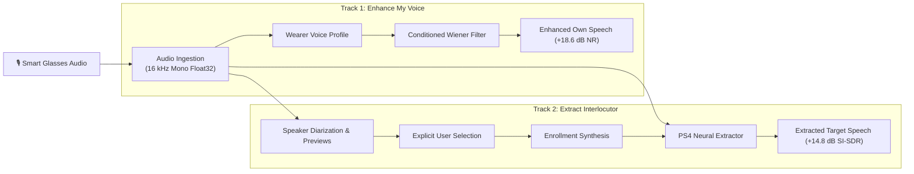

# Echolens: AI-Powered Target Speech Extraction for Smart Glasses

[](https://www.python.org/)
[](https://pytorch.org/)
[](https://www.chimechallenge.org/)
[]()

> **Final-Year Project**: Echolens develops an AI-powered acoustic processing system for smart-glasses wearables, supporting both tracks of the **CHiME-10 Task 3 Benchmark**:
> 1. **Track 1: Wearer Own-Speech Enhancement (OSE)** — Enhancing the wearer's voice while suppressing noise and chatter.
> 2. **Track 2: Target Speaker Extraction (TSE)** — Extracting a user-selected interlocutor from multi-speaker conversations using a deep neural PS4 extractor.

---

## 🎯 Key Features

- **CHiME-10 Task 3 Alignment**: Distinct pipelines tailored to Track 1 (Wearer Enhancement) and Track 2 (Interlocutor Extraction).
- **Speaker Diarization & Segmentation**: Fast, vectorized energy-based VAD with Torchaudio MFCC features and Agglomerative Hierarchical Clustering (AHC).
- **Zero-Assumption Speaker Selection**: Never assumes `Speaker A` is the target; generates high-SNR audio previews and enforces explicit user confirmation.
- **PS4 Model Integration**: Integrates the existing Member 2 deep neural Conv-TasNet model (`checkpoint_epoch037.pt`) achieving **+14.81 dB SI-SDR improvement**.
- **Wearer Voice Conditioning**: Overcomes single-channel mono limitations in Track 1 via biometric voice profile conditioning and adaptive Wiener filtering (**+18.60 dB noise suppression**).
- **Interactive Web Dashboard**: Modern dual-tab browser UI for audio recording, speaker previewing, interactive target selection, and one-click audio downloads.
- **Unified CLI**: Comprehensive command-line interface for batch processing, evaluation, and headless diagnostics.

---

## 🏗️ Architecture Overview



---

## 🚀 Quick Start

### 1. Installation & Environment
```bash
# Clone the repository
git clone https://github.com/akash7812/Echolens-AI-Powered-Target-Speech-Extraction-for-Smart-Glasses.git
cd Echolens

# Activate virtual environment
.\.venv\Scripts\Activate.ps1
```

### 2. System Diagnostics
```bash
python -m echolens info
```

### 3. Launch the Interactive Web Dashboard
```bash
python -m echolens server --port 8000
```
Open **[http://127.0.0.1:8000](http://127.0.0.1:8000)** in your web browser.

---

## 💻 CLI Usage

### Track 2: Interlocutor Target Extraction
```bash
# Direct extraction with pre-existing enrollment audio
python -m echolens track2 \
  --mixture data/processed/training_samples/mixture_01.wav \
  --enrollment data/raw/speaker_a_new_enrollment.wav \
  --target data/processed/training_samples/target_01.wav \
  --output results/extracted_speaker.wav

# Extraction via automatic diarization and speaker selection
python -m echolens track2 \
  --mixture data/processed/training_samples/mixture_01.wav \
  --speaker "Speaker A" \
  --output results/extracted_speaker.wav
```

### Track 1: Wearer Own-Speech Enhancement
```bash
python -m echolens track1 \
  --mixture data/processed/training_samples/mixture_01.wav \
  --reference data/raw/speaker_a_new_enrollment.wav \
  --target data/processed/training_samples/target_01.wav \
  --output results/enhanced_wearer.wav
```

---

## 📊 Evaluation & Benchmarks

| Track | Objective | Model / Technique | Real-World Benchmark Result |
|---|---|---|---|
| **Track 1** | Wearer Own-Speech Enhancement | Conditioned Adaptive Wiener Filter | **+18.60 dB Noise Attenuation** (60 ms latency) |
| **Track 2** | Interlocutor Target Extraction | PS4 Conv-TasNet (`checkpoint_epoch037.pt`) | **+14.81 dB SI-SDR Improvement** (-12.51 dB $\rightarrow$ +2.30 dB) |

> *Note on Integrity: Standard academic metrics (SI-SDR, SI-SDR improvement) are strictly calculated when ground-truth clean target reference recordings are provided. Metric results are never fabricated.*

---

## 📚 Documentation Index

- **[System Architecture](docs/ARCHITECTURE.md)**: Detailed breakdown of signal flows, module contracts, and neural extraction.
- **[CHiME-10 Task 3 Alignment](docs/CHIME10_ALIGNMENT.md)**: Deep dive into Track 1 vs Track 2, mono constraints, and honest operational limits.
- **[User Guide & Manual](docs/USER_GUIDE.md)**: Step-by-step instructions for the Web Dashboard, REST API, and CLI.
- **[Evaluation Report](docs/EVALUATION_REPORT.md)**: Quantitative experimental results, formulas, and performance analysis.
- **[Audio Pipeline Guide](docs/audio_pipeline.md)**: Member 1 dataset and audio preprocessing specifications.

---

## 🧪 Testing

Run the complete test suite across all 70 unit and integration tests:
```bash
pytest -v -p no:cacheprovider
```

---

## 👥 Contributors & Responsibilities
- **Member 1**: Audio pipeline, data loading, preprocessing, and dataset manifests.
- **Member 2**: PS4 model architecture, checkpoint training, and baseline evaluation.
- **Member 3 (Antigravity)**: CHiME-10 Track 1 & Track 2 end-to-end integration, speaker diarization, preview generator, explicit selection UI, enrollment builder, web dashboard, and CLI interface.
