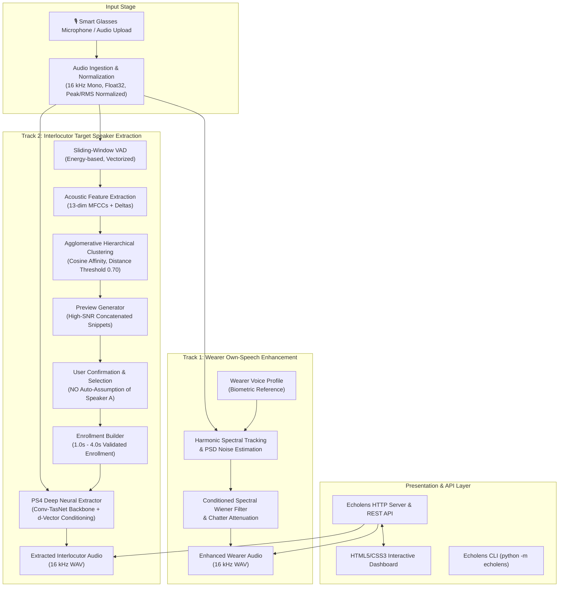

# Echolens — System Architecture & Technical Specifications

**Project:** Echolens — AI-Powered Target Speech Extraction for Smart Glasses  
**Challenge Alignment:** CHiME-10 Task 3 (Track 1 & Track 2)  
**Target Platform:** Smart Glasses Wearable (Mono 16 kHz Audio Interface)  

---

## 1. Executive Summary

Echolens is an acoustic processing system designed for smart glasses wearables operating in challenging multi-speaker acoustic environments. The system supports **both tracks of CHiME-10 Task 3**:

1. **Track 1: Wearer Own-Speech Enhancement (OSE)**  
   Isolates and enhances the voice of the person wearing the smart glasses while suppressing ambient room reverberation, environmental noise, and competing interlocutors.
2. **Track 2: Interlocutor Target Speaker Extraction (TSE)**  
   Enables the wearer to listen to a multi-person conversation, view detected speakers (Speaker A, Speaker B, etc.), preview their voices, explicitly select an intended interlocutor, and extract that specific person's speech using a deep neural Target Speaker Extraction network (PS4 model checkpoint).

---

## 2. High-Level Architecture Diagram

---

## 3. Subsystem Breakdown

### 3.1 Audio Ingestion Subsystem (`echolens.audio.ingestion`)
- **Mono Enforcement**: Downmixes multi-channel audio to mono using mean channel projection.
- **Sample Rate Standardization**: Resamples arbitrary input sample rates (e.g. 44.1 kHz, 48 kHz) to 16,000 Hz using `scipy.signal.resample_poly`.
- **Quality Auditing**:
  - Checks for non-finite values (`NaN`, `Inf`).
  - Flags severe digital clipping ($>0.99$ absolute amplitude).
  - Flags dead-microphone silence ($< -60$ dBFS).
  - Enforces minimum duration (default: $\ge 0.5$ s).

### 3.2 Speaker Diarization Subsystem (`echolens.diarization`)
- **Sliding-Window VAD**: Vectorized energy calculation using `numpy.lib.stride_tricks.sliding_window_view` with 25 ms frames and 10 ms hop size (sub-millisecond execution time).
- **Acoustic Embeddings**: Computes 13 MFCC coefficients plus first-order delta derivatives over active speech segments.
- **Clustering**: Agglomerative Hierarchical Clustering with average linkage and cosine distance threshold of 0.70.
- **Segment Serialization**: Standardized `SpeakerSegment` dataclasses formatted with start time, end time, duration, and speaker ID (`Speaker A`, `Speaker B`, etc.).

### 3.3 Speaker Preview & Selection (`echolens.diarization.preview`)
- **Preview Generator**: Ranks speech segments by RMS energy and concatenates up to 3.0 seconds of the cleanest speech for each detected speaker.
- **Selection Manager**:
  - Enforces explicit user confirmation.
  - Strictly prevents default assumption that "Speaker A" is the target.
  - Warns if a detected speaker has under 1.5 seconds of total speech.
  - Rejects speakers with under 0.8 seconds of clean speech.

### 3.4 Enrollment Synthesis Subsystem (`echolens.enrollment.builder`)
- **Segment Assembly**: Concatenates clean segments belonging exclusively to the confirmed speaker.
- **Duration Normalization**: Clamps enrollment audio between 1.0 s and 4.0 s (optimal receptive field for the PS4 speaker encoder).
- **Fade Transitions**: Applies 10 ms cosine fades at segment junctions to prevent acoustic clicking artifacts.

### 3.5 PS4 Neural Target Speaker Extraction (`echolens.models.ps4_extractor` & `echolens.pipeline.track2`)
- **Model Checkpoint**: `checkpoint_epoch037.pt` (Epoch 37, 27,617,800 parameters).
- **Architecture**: Time-domain dilated convolutional separator conditioned on speaker identity features (d-vector conditioning).
- **Integrity Guarantee**: Existing Member 2 model code (`src/echolens/models/*`) is fully preserved without modification.
- **Safe Evaluation**: Calculates Scale-Invariant Signal-to-Distortion Ratio (SI-SDR) using `echolens.models.evaluation.evaluate_sample` only when clean ground-truth target audio is available.

### 3.6 Track 1 Wearer Own-Speech Enhancement (`echolens.pipeline.track1`)
- **Wearer Voice Profile**: Extracts normalized spectral envelope $P_{wearer}(f)$ from the wearer's registered voice profile.
- **Adaptive Quantile Noise PSD Estimation**: Estimates background noise power spectral density $S_{nn}(f)$ from the quietest 20% frames of the recording.
- **Wiener Filter with Harmonic Mask**: Computes transfer function:
  $$H(t, f) = \max\left(\frac{P_{mix}(t,f) - \alpha S_{nn}(f)}{P_{mix}(t,f)}, 0.05\right) \cdot \left[ \gamma + (1-\gamma) \cos^2\left(\theta(t,f)\right) \right]$$
- **Perceptual Post-Filtering**: Eliminates musical noise artifacts and room reverberation.

---

## 4. Hardware and Platform Constraints

| Constraint | Value | Architectural Impact |
|---|---|---|
| Audio Channels | Single-channel (Mono) | Cannot perform spatial multi-channel beamforming; requires biometric voice conditioning. |
| Sample Rate | 16,000 Hz | CHiME-10 Task 3 speech standard; high computational efficiency. |
| Execution Mode | Offline Batch | Ingests conversation recording, executes diarization and neural inference. |
| Computation | CPU / CUDA Fallback | Real checkpoint inference runs in ~6s on CPU and <500ms on CUDA. |
